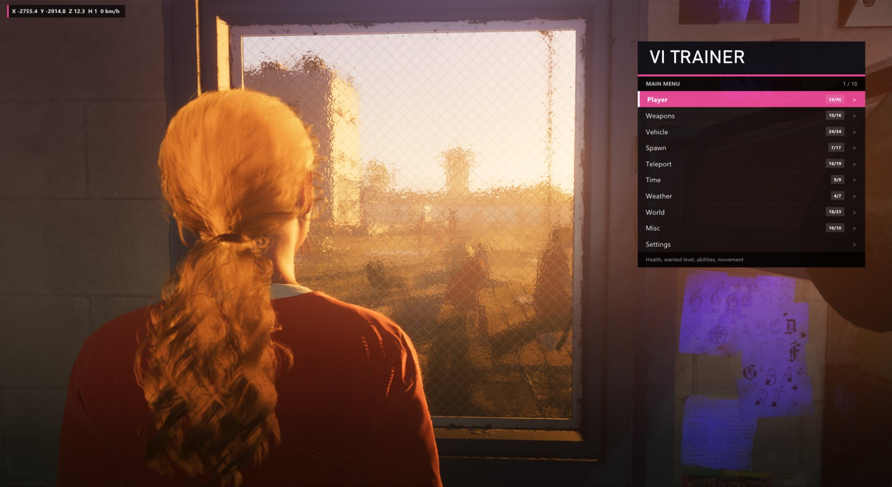
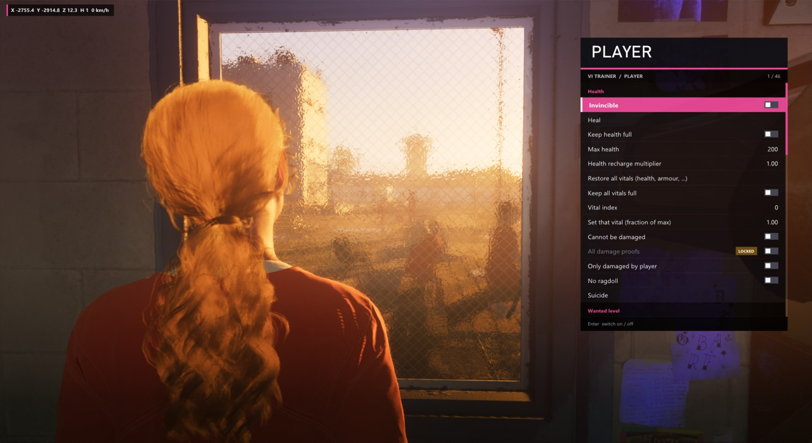
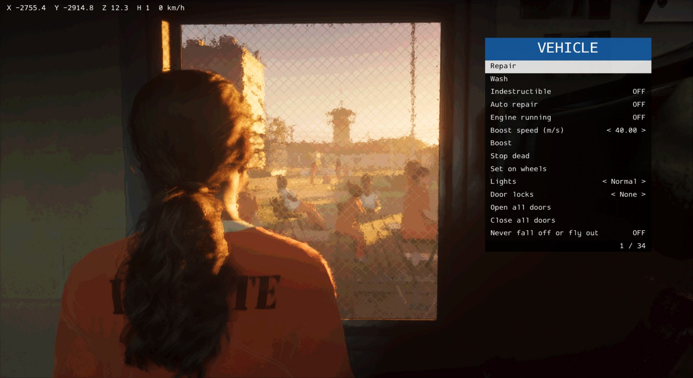
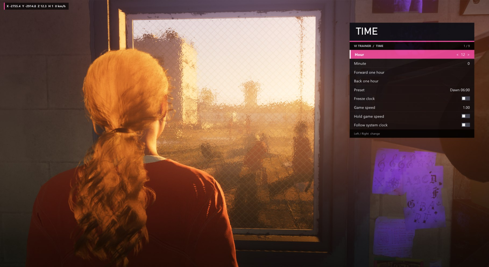

<h1 align="center">ScriptHook VI</h1>

<p align="center">
  <b>A script hook, native SDK and mod-menu toolkit for GTA VI story mode.</b><br>
  C ABI for plugins · typed NativeDB · fiber scripts · D3D12 overlay · fail-closed online guard
</p>

<p align="center">
  
  
  
  
</p>

<p align="center">
  <br>
  <sub>The sample trainer in the first story scene: Xbox exe 1.0.2.1 running on Windows under a VIctory-based layer</sub>
</p>

> [!IMPORTANT]
> **There is no GTA VI PC build yet.** Everything here runs today against the **Xbox Series executable
> (`game_scarlett_master.exe`, version 1.0.2.1)**, executed on Windows by a work-in-progress
> **Xbox-to-PC compatibility layer based on [VIctory](#how-it-runs-today-the-victory-host)**
> (the fork in use is p1nkman-VI). The hook is loaded into that process through a small host patch.
>
> All signatures, offsets and native tables are **per game build** and must be re-derived for every
> version (and for the PC release). The goal of the project is a **generic hook**: one core, plus a small
> per-build profile produced by tools in this repo, rather than a hook tied to a single build.

## Contents

- [What it is](#what-it-is)
- [One engine, every platform: PC, PS5, simulator](#one-engine-every-platform-pc-ps5-simulator)
- [Screenshots](#screenshots)
- [How it runs today: the VIctory host](#how-it-runs-today-the-victory-host)
- [Current progress](#current-progress)
- [Roadmap](#roadmap)
- [Architecture](#architecture)
- [Build](#build)
- [Run it](#run-it)
- [Writing a plugin](#writing-a-plugin)
- [NativeDB](#nativedb)
- [What is (and is not) in this repository](#what-is-and-is-not-in-this-repository)
- [Scope and rules](#scope-and-rules)
- [Docs](#docs)

## What it is

ScriptHook VI does for GTA VI what ScriptHookV did for GTA V: it loads plugins (`.asi`) into the game and
lets them run script code every frame, call the game's natives, read the world and draw a menu.

GTA VI is not GTA V with new content. The script VM is a C#-like IL runtime with linked modules, natives
have no stable name hashes (the VM calls handlers by build-specific code offset), and entity handles are
16-byte GUIDs. So the hook is written from the VI binary, not ported from GTA V:

| Piece | What it does |
|---|---|
| **Loader** | A proxy DLL (`dinput8.dll` / `version.dll`, or any DLL the exe imports via `shvi_pick_proxy`), or a *hosted start* when a compatibility layer loads the core directly |
| **Scanner + profiles** | Multi-candidate signatures with validators locate ~18 engine targets per build (script VM, script manager update, string hash, TLS thread slot, opcode permutation, native base, ...). If one is missing the hook stays inert and logs which |
| **Tick** | A detour on the script manager update runs plugin scripts once per frame, on a script thread, behind a game-ready gate |
| **Invoker** | Calls native handlers with the VI 24-byte native context, vector fix-up, SEH guards and a denylist |
| **Native table** | Per-build `shvi/natives/<PE timestamp>.json`; the loader refuses other builds and checks each handler id before binding a name |
| **Fiber scheduler** | `script_wait`, crash isolation per script, removal |
| **Online guard** | Reads the game mode; plugins run only in story mode, and the guard latches off for the session on an online session or a loaded anti-cheat client |
| **Overlay** | Generic DXGI/D3D12 hooks + Dear ImGui DX12 backend; plugins draw through a double-buffered draw list |
| **SDK** | Stable C ABI (`shvi.h`), C++ sugar (`shvi.hpp`), menu toolkit (`ui.hpp`), typed natives (`natives_full.hpp`) |

## One engine, every platform: PC, PS5, simulator

One mod source builds for every platform. The SDK picks the binary format, and the `shvi` CLI does the rest:

```sh
shvi new                      # guided: name, platforms (PC / PS5), language (C++ / C), template, CI workflow
shvi build                    # pc -> <mod>.asi   ps5 -> <mod>.elf + shvi_loader.elf   (PS5 via WSL on Windows)
shvi test                     # run the mod offline in the simulator: no game, scripted keys, menu as text
shvi package                  # dist/<mod>-<version>-pc.zip / -ps5.zip
shvi deploy ps5 --host <ip>   # FTP the image, send the loader to the console's ELF loader (asks first)
```

| Platform | Mod binary | Host | State |
|---|---|---|---|
| **PC** (`win64`) | `<mod>.asi` | `src/core` (this README) | in game ✅ |
| **PS5** (`ps5`) | `<mod>.elf`: the mod + PS5 runtime + portable engine, one payload ELF; plus `shvi_loader.elf` | [`platforms/ps5`](platforms/ps5/README.md) | builds ✅, host-tested ✅, dry run and loader on console 🧪, in-game mapping 📐 |
| **Simulator** (`sim`) | `<mod>.so`, or the PC `.asi` | `tools/sim` on `src/engine` | ✅ CI |

- **Templates**: `blank` (C or C++), `menu`, `trainer` (a mod-menu trainer whose features appear only when the
  running build binds their natives). Each one is generated, built and run in CI on Windows, Linux and PS5.
- **SDK**: `sdk/include` (the C ABI and C++ layers, unchanged ABI 1.6) plus `sdk/cmake/ShviMod.cmake`
  (`shvi_add_mod()`) and `sdk/cmake/toolchains/ps5.cmake` (ps5-payload-sdk). Mods register with `SHVI_THIS_MODULE`;
  `shvi/platform.h` gives the data folder on each platform; the PS5 pad arrives as the same key codes (L1+R3 = F4).
- **Portable engine** (`src/engine`): the `shvi_api` table, a fiber/ucontext script scheduler, the plugin loader.
  The simulator and the PS5 runtime use it; the Windows core keeps its in-game verified implementation of the same ABI.
- **Install the CLI**: `curl -fsSL https://github.com/modpapi/scripthook-vi/releases/latest/download/install.sh | bash`
  (or `install.ps1` with `irm … | iex` on Windows), or from a checkout `cd tools/shvi-cli && bun link`.
- **GitHub automation**: `.github/workflows/ci.yml` builds and tests win64, sim and ps5 (with ps5-payload-sdk) and
  runs the CLI end to end. `release.yml` publishes the SDK, the CLI binaries and the install scripts on `v*` tags.
  Generated mods get their own `build.yml` (simulate, pc, ps5, release).

The mod developer guide is [docs/SDK.md](docs/SDK.md).

## Screenshots

<table>
  <tr>
    <td width="33%"></td>
    <td width="33%"></td>
    <td width="33%"></td>
  </tr>
  <tr>
    <td align="center"><b>Player</b>: 46 features; <code>[locked]</code> ones wait for a stronger native name</td>
    <td align="center"><b>Vehicle</b>: 34 features</td>
    <td align="center"><b>Time</b>: clock, presets, game speed</td>
  </tr>
</table>

Captured on 2026-11-26 (Xbox exe 1.0.2.1 under p1nkman-VI `9aaa9ec`, RTX 3050 Laptop, 1920×1080, a few fps).
The menu, the overlay and the coordinate line at the top left come from ScriptHook VI and the sample
trainer. The root page counts the features bound for this build in each category: in that run 171 of
181 were available, 51 of them experimental. The menu was opened with F4 and driven by keyboard.

## How it runs today: the VIctory host

[VIctory](https://github.com/Marvisak/VIctory) is an open-source (GPL-3.0) layer that runs the Xbox Series build of GTA VI on
Windows: it maps the title, provides the Xbox system libraries and translates the GPU work to D3D12.
The fork used for the current runs is **p1nkman-VI** ([codeberg.org/p1nkman/p1nkman-VI](https://codeberg.org/p1nkman/p1nkman-VI), commit `9aaa9ec`; itself based on community VIctory forks).

```
 victory.exe ─ maps game_scarlett_master.exe
     │
     ├─ VICTORY_LOAD_DLLS=…\shvi\shvi_core.dll      (hosts/victory/load_host_dlls.patch)
     │       └─ shvi_core!victory_on_title_mapped(image base, size, exe path)   ← "hosted start"
     │             scan the mapped image → install tick detour, DXGI hooks, guard
     │
     └─ title code runs → script manager ticks → plugins (trainer.asi, …) run on script threads
```

- The layer has **no plugin loading upstream**. `hosts/victory/load_host_dlls.patch` (about 60 lines,
  GPL-3.0 like the code it patches) adds `VICTORY_LOAD_DLLS`: each listed DLL is loaded and its
  `victory_on_title_mapped` export is called once the title is mapped, before any title code runs.
- The hook needs nothing else from the layer. It copes with the layer's rewrites (for example `gs:[58h]`
  TLS reads become a thunk call, and the hook calls the same thunk).
- The layer itself is changing fast and each fork/commit behaves differently (frame rate, which data
  folder works, which scenes play). The run recipe in [Run it](#run-it) is the one that works on the
  commit above.

**Why per-version adaptation is needed.** Three things are tied to one build of one platform:

1. the **signature profile** (`src/games/gta6/gta6_profile.cpp`): patterns, validators, operand keys,
   opcode multiplier and offsets for the Xbox 1.0.2.1 exe;
2. the **native table** (`nativedb/db/1794606036/`): handler ids and RVAs differ in every build;
3. the **host glue**: the hosted start for the layer today, the proxy DLL for the PC build later.

The generic part (scanner, invoker, fibers, guard, overlay, ABI, SDK, menu toolkit) is already
build-independent. The roadmap below is about making the per-build part *generated* rather than written by
hand: run `shvi_scan` and the NativeDB census on a new exe, get a profile and a table, done.

## Current progress

Legend: ✅ done and verified in game · 🧪 done, unit-tested, not yet confirmed in game · 🚧 in progress · 📐 designed · ⏳ waiting on the PC release

### Core and SDK

| Part | State | Notes |
|---|---|---|
| Hosted start under the VIctory-based layer | ✅ | Every run since 2026-11-24 |
| Signature scan of the live image (18 targets) | ✅ | Same profile resolves offline with `shvi_scan` (ctest `scan_gta6_xbox`) |
| Per-frame tick, game-ready gate, worker-thread pinning | ✅ | Scripts run on worker threads; the gate follows them |
| Online guard (story mode = `joaat("Story000")`, read live) | ✅ | Reports offline in story mode; latch unit-tested |
| Native table binding with handler-id check | ✅ | 41/41 default names; all 181 trainer features bound with the full table |
| Natives called and read back | ✅ | Clock, health, wanted cap, coordinates, visibility, alpha, collision, accuracy, weather, vehicles |
| Fiber scheduler, `script_wait`, crash isolation | ✅ | |
| Keyboard (`keyboard_register`, window subclass) | ✅ | F4 / arrows / Enter / Backspace drive the trainer |
| D3D12 overlay + `present_register` + `UI_DRAW_RECT/TEXT` | ✅ | WARP ctests + in game (screenshots above) |
| Entity API (`world_get_all`, `entity_ptr`), `static_ptr` | ✅ / 🧪 | Pool walk seen in game (peds, vehicles, objects); statics only unit-tested |
| `script_function_call` (ABI 1.6): call a function of a linked script | ✅ | Runs on the borrowed script thread |
| Async natives (`Task<T>`) such as spawning peds and vehicles | 🚧 | Creation returns a task; the object does not appear yet (script-heap context) |
| Proxy loader for the PC build | 🧪 | Forwarding verified by test; no PC exe to load into yet |
| GTA VI PC profile | ⏳ | Placeholder, starts from the Xbox signature set |

### NativeDB and samples

| Part | State | Notes |
|---|---|---|
| Native census of the exe | ✅ | 6,829 handlers, matched against an independent IDA census with nothing unexplained |
| Typed NativeDB (`natives.json`, alloc8or layout) | ✅ | All 6,829 typed; 2,034 named with a confidence level; names checked by code-layout order |
| Generated C++ wrappers `natives_full.hpp` | ✅ | 6,823 wrappers, `shvi::nativedb::<NS>::<NAME>` |
| Sample trainer (`samples/trainer`) | ✅ / 🚧 | 181 features in 9 categories; a few dozen confirmed in game by read-back, most others bound but not yet checked |
| Sample menu (`samples/menu_demo`), C sample (`samples/hello_engine`) | ✅ | `hello_engine` calls the game's string hash in game and matches the SDK |
| Script inventory (logs every linked program) | ✅ | |
| Script function hooks (in-VM detours) | 📐 | `docs/SCRIPT_MODDING.md` |
| .NET / Lua hosts | 📐 | `tick_register` (ABI 1.1) is the entry point |

## Roadmap

### Phase A: Xbox build under the layer (now)

- [x] Hook, tick, guard, overlay, native table and trainer working in the first gameplay scene
- [x] NativeDB census, typing, naming, generated SDK headers
- [ ] Async natives (`Task<T>`): spawn peds / vehicles / give items through the game's own script wrappers
- [ ] Confirm the remaining trainer features by read-back (wanted level, abilities, vitals, weather overrides)
- [ ] Name more natives (behaviour checks; the 2,850 ranked candidates)

### Phase B: make the per-build part generic

- [ ] `shvi_scan --emit-profile`: resolve targets on any build and write a data profile instead of C++ code
- [ ] One-command NativeDB census + table for a new exe (`shvi_nativedb`), carrying names over by handler
      layout and call-site shape
- [ ] Host-agnostic start: the same core under the proxy loader, the VIctory hosted start, and other
      layers, with no `#ifdef` per host
- [ ] Profile/table versioning in `shvi/natives/<PE timestamp>.json`; refuse unknown builds by default

### Phase C: PC release day

- [ ] Triage the PC exe: graphics API, proxy DLL (`shvi_pick_proxy`), build id, anti-cheat presence
- [ ] Port the Xbox signature set to a `Gta6Pc` profile until `shvi_scan` passes
- [ ] First boot in story mode, offline; check tick, guard, mode values and layouts in the log
- [ ] Verify the online latch on the PC build's online entry points

### Phase D: parity and beyond

- [ ] Plugin unload / reload hotkeys with fiber teardown
- [ ] Script function hooks (`script_hook`) and story statics by module + field
- [ ] CoreCLR host (ScriptHookVDotNet style), then Lua
- [ ] Release packaging and a user-facing install guide

## Architecture

```
 plugins (.asi)            samples/trainer, samples/menu_demo, samples/hello_engine
     │  C ABI  shvi.h (ABI 1.6)
 ┌───┴──────────────────────────────────────────────────────────────────────────────┐
 │ src/core (generic)                                                               │
 │  loader/hosted start · scanner + PE mapper · invoker · fibers · online guard     │
 │  native table loader · denylist · keyboard · D3D12 overlay · log                 │
 └───┬──────────────────────────────────────────────────────────────────────────────┘
     │  game profile interface
 ┌───┴──────────────────────────────────────────────┐   ┌──────────────────────────┐
 │ src/games/gta6 (per build)                       │   │ nativedb/db/<PE stamp>/  │
 │  Xbox 1.0.2.1 signatures, script runtime model,  │   │  natives.json, table     │
 │  mode values, thread context      PC: ⏳         │   │  → sdk natives_full.hpp  │
 └──────────────────────────────────────────────────┘   └──────────────────────────┘
```

Details: [docs/ARCHITECTURE.md](docs/ARCHITECTURE.md).

## Build

Requires Visual Studio 2022 or 2026 (MSVC, MASM) and CMake ≥ 3.24. MinHook v1.3.4 and Dear ImGui v1.93.0
are fetched at configure time, pinned by commit.

```bat
cmake -S . -B build -G "Visual Studio 18 2026" -A x64
cmake --build build --config Release
ctest --test-dir build -C Release --output-on-failure
cmake --install build --config Release --prefix dist
```

Other platforms (the same tree): `cmake -S . -B build/sim` on Linux/macOS (engine, simulator, samples as `.so`,
tests), and `cmake -S . -B build/ps5 -DCMAKE_TOOLCHAIN_FILE=sdk/cmake/toolchains/ps5.cmake` with ps5-payload-sdk
(`shvi_loader.elf` and the samples as PS5 mod images).

The unit tests need no game. With your own copy of the exe, `-DSHVI_GTA6_XBOX_EXE=<path>` adds the offline
signature and crossmap checks as ctests.

### Check signatures offline

```bat
dist\tools\shvi_scan.exe <path>\game_scarlett_master.exe          :: resolve the matching profile's targets
dist\tools\shvi_scan.exe <exe> --all                                :: every profile's targets
dist\tools\shvi_scan.exe <exe> --hash 144FC21D0 "Models\Adder"     :: call a pure u32(const char*, seed) by IDA VA
```

The exe is mapped like the loader would map it (sections at their RVAs, relocations applied) but never
started. Only pure functions such as the string hash are ever called.

## Run it

### Under the VIctory-based layer (today)

You need your own legally obtained copy of the Xbox build, and a build of the layer with
`hosts/victory/load_host_dlls.patch` applied.

1. Build and install ScriptHook VI (above).
2. Copy `dist\game\shvi\` next to `game_scarlett_master.exe`:
   `<game>\shvi\shvi_core.dll`, `<game>\shvi\plugins\*.asi`, `<game>\shvi\natives\1794606036.json`.
   For the trainer's full feature set use `nativedb\db\1794606036\native_table_full.json` as that json.
3. Optional: an empty `<game>\shvi\overlay_test.on` draws a magenta rect every frame (proves the overlay).
4. Start the layer with the hook:

   ```powershell
   $env:VICTORY_LOAD_DLLS = "<game>\shvi\shvi_core.dll"
   .\target\release\victory.exe run "<game>\game_scarlett_master.exe" --execute
   ```

5. Press **F4** in the game window to open the trainer. Arrows / numpad move, Enter selects, Backspace goes
   back.

`<game>\shvi\shvi.log` shows `(hosted start)`, the scan report, the DXGI hooks, the guard's mode changes,
the script inventory and plugin results. The layer's own README warnings apply: it runs your copy of the
game and can hang the GPU.

### On the PC build (when it exists)

Copy `dist/game/*` into the game folder (`dinput8.dll`, `shvi\shvi_core.dll`, `shvi\plugins\*.asi`), start
story mode offline, and read `shvi\shvi.log`. Until a PC profile exists the hook stays inert and says
which target is missing.

## Writing a plugin

### C

```c
#include <shvi/shvi.h>
static const shvi_api* api;

static void main_loop(void* user) {
    for (;;) {
        api->native_init(shvi_engine_hash("STRING_HASH"));  /* a function the profile bound */
        api->native_push64(shvi_p2u("name"));
        api->native_push64(0);
        uint32_t h = (uint32_t)api->native_call()[0];
        /* ... */
        api->script_wait(0);
    }
}
SHVI_PLUGIN_EXPORT int shvi_plugin_load(const shvi_api* a) {
    if (!shvi_api_compatible(a)) return SHVI_E_ABI_MISMATCH;
    api = a;
    return a->script_register(SHVI_THIS_MODULE, main_loop, NULL);  /* same on PC and PS5 */
}
```

Natives can only be called from script callbacks (fibers) and `tick_register` callbacks. Calls from
`shvi_plugin_load`, keyboard callbacks or your own threads are refused.

### C++ with the typed NativeDB and a menu

```cpp
#include <shvi/shvi.hpp>
#include <shvi/natives_full.hpp>
#include <shvi/ui.hpp>
#include <shvi/vi_ui.hpp>

shvi::ui::InputQueue g_input;  // a->keyboard_register(&shvi::ui::InputQueue::OnKey, &g_input) in shvi_plugin_load

void ScriptMain(void*) {
    using namespace shvi;
    using namespace shvi::nativedb::all;
    ui::Style style;
    ui::Menu menu("MY MOD");
    menu.Root().Button("Heal", [] { auto me = PLAYER_PED_ID(); SET_ENTITY_HEALTH(me, GET_ENTITY_MAX_HEALTH(me, false), {}, false, false); });
    vi::EngineBackend backend;
    for (;;) {
        for (ui::Action a; (a = g_input.Pop()) != ui::Action::None;) menu.Handle(a);  // F4 opens
        if (menu.IsOpen()) vi::DisableMenuControls();
        ui::Submit(backend, menu.Layout(style));
        wait(0);
    }
}
```

GTA VI natives have no name hashes, so the host binds names from the per-build table:
`shvi_engine_hash("NAME")` / `shvi::sdk::EngineHash("NAME")` = `0x5649 << 48 | atStringHash(name)`.
An unbound name returns zeros, and `native_exists` (ABI 1.5) tells a plugin what is available.
`samples/trainer` shows the full pattern (gating by availability and name confidence, per-frame holds).

## NativeDB

`nativedb/db/1794606036/natives.json` follows the layout of the GTA V / RDR2 NativeDBs
(`{NAMESPACE: {"0x<hash>": {name, params, return_type, comment}}}`) plus a `vi` object per native: handler
RVA, argument and return cell counts, name confidence and the evidence behind each type.

| | |
|---|---|
| Natives | 6,829 (every handler in the 1.0.2.1 exe) |
| Typed (params, return type, cell counts) | 6,829 |
| Named | 2,034, each with a confidence level |
| Unnamed with ranked candidate names | 2,850 |

Every name carries a confidence (`behaviour-checked`, `corroborated`, `guide`, `inferred-*`, ...).
The trainer only enables features whose natives meet a confidence bar. Details and method:
[docs/NATIVEDB.md](docs/NATIVEDB.md).

## What is (and is not) in this repository

The repository follows what the GTA V / RDR2 modding projects publish: **code, and metadata about
natives (names, ids, parameter types)**. It does **not** contain any game files or game-derived content:

- no game executables, archives, assets, shaders or script programs;
- no decompiled game scripts or game code, and no tables copied from third-party script dumps;
- no encryption keys or anything that decrypts game archives;
- no anti-cheat or DRM bypass of any kind.

To run or re-derive anything you need your own copy of the game. The research tooling that works on the
exe (IDA databases, query scripts) stays outside the repository.

## Scope and rules

- **Story mode, offline, non-commercial.** The online guard switches the hook off permanently for the
  session when it detects an online session or a loaded anti-cheat client. There is no evasion code.
- Plugins that crash are isolated and removed; a fault in a native call is caught and logged.
- Not affiliated with or endorsed by Rockstar Games or Take-Two Interactive. GTA VI is their trademark.
  Screenshots show the game for identification and documentation only.

## Docs

| Doc | What it covers |
|---|---|
| [docs/ARCHITECTURE.md](docs/ARCHITECTURE.md) | Layer diagram, layers A to G |
| [docs/REFERENCE_ANALYSIS.md](docs/REFERENCE_ANALYSIS.md) | How ScriptHookV-era projects locate natives, invoke them, impersonate threads and schedule scripts |
| [docs/SCRIPT_MODDING.md](docs/SCRIPT_MODDING.md) | The VI script runtime (C#-like IL, linked modules), the engine's script patch system, routes to mod scripts and draw menus |
| [docs/SDK.md](docs/SDK.md) | Mod developer guide: the `shvi` CLI, templates, `shvi_add_mod`, portable mods, the simulator, PS5 |
| [platforms/ps5/README.md](platforms/ps5/README.md) | The PS5 platform: runtime, loader payload, status; design notes in [docs/ps5/](docs/ps5/) |
| [docs/NATIVEDB.md](docs/NATIVEDB.md) | The NativeDB: files, hashes, naming method and confidence levels |
| [docs/TRAINER.md](docs/TRAINER.md) | The sample trainer: features, gating, what was confirmed in game |
| [hosts/victory/](hosts/victory/) | The host patch for VIctory-based layers |

## Layout

```
sdk/include/shvi/   shvi.h (C ABI), shvi.hpp, platform.h, ui.hpp, vi_ui.hpp, natives_vi.hpp, natives_full.hpp
sdk/cmake/          ShviMod.cmake (shvi_add_mod, shvi_add_ps5_loader), toolchains/ps5.cmake
src/engine/         PORTABLE engine: shvi_api host, fiber/ucontext scheduler, plugin loader (sim, PS5)
platforms/ps5/      PS5: runtime (engine + pad + log), loader payload (shvi_loader.elf), self2elf, tests
src/loader/         generic proxy: MASM jump stubs + per-DLL export lists
src/core/           GENERIC: scanner, PE, invoker, fibers, guard, crossmap, native table, overlay, core DLL
src/games/gta6/     PER BUILD: Xbox 1.0.2.1 signatures, script runtime model, PC placeholder
nativedb/db/        NativeDB per build (PE timestamp)
crossmap/           default per-build native table
hosts/victory/      host patch for VIctory-based compatibility layers
tools/              shvi_scan, shvi_pick_proxy, shvi_nativedb, sim (shvi_sim), shvi-cli (bun), release
.github/workflows/  ci.yml (win64 + sim + ps5 + CLI e2e), release.yml (SDK + CLI binaries on v* tags)
samples/            hello_engine (C), menu_demo (C++), trainer (C++, 181 features)
tests/              unit tests (no game), proxy forwarding, NativeDB, D3D12 overlay (WARP)
assets/             README screenshots
```
